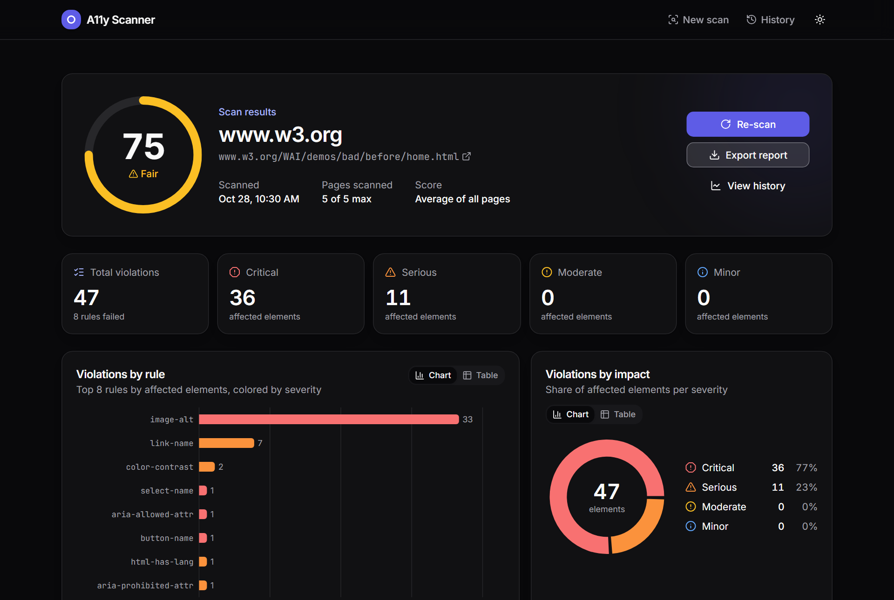
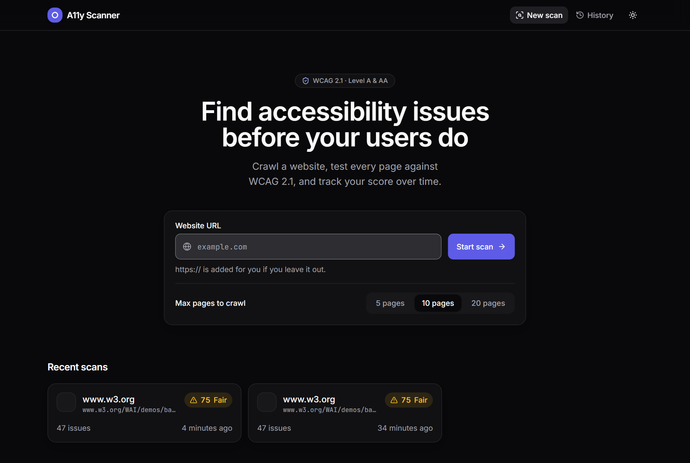
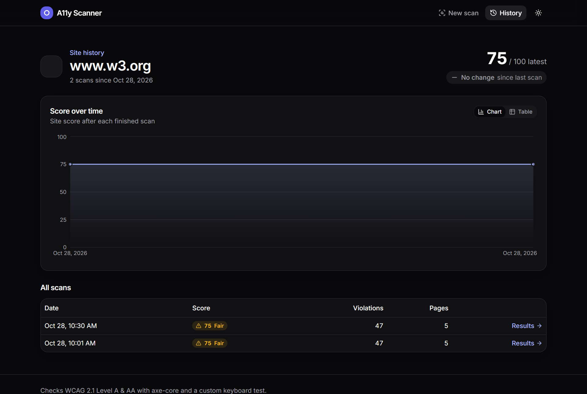

# A11y Scanner

An automated web accessibility auditor. It crawls a website, checks every page against **WCAG 2.1 Level A and AA**, adds a custom keyboard-navigation test, gives each scan a **score from 0 to 100**, and shows compliance over time on a dashboard.



| New scan | Score history |
|---|---|
|  |  |

## Features

- **Page scanner**: loads each page in headless Chromium (Playwright) and runs the axe-core rule engine with the `wcag2a`, `wcag2aa`, `wcag21a` and `wcag21aa` tags.
- **Crawler**: breadth-first search over same-domain links, with URL normalization, robots.txt support, a 500 ms delay between requests, and a page limit (20 by default).
- **Keyboard check** (custom, beyond axe): presses Tab up to 50 times, records the focus order, and flags focus traps and elements with no visible focus indicator.
- **Scoring**: a weighted penalty per affected element, plus a site score that averages the page scores.
- **Reports**: a JSON file and a standalone HTML report for every scan.
- **REST API + SQLite**: stores the history of sites, scans, pages and violations.
- **Dashboard** (React + TypeScript): start scans, watch live progress, explore results by impact, rule, page and keyboard focus order, export JSON, and follow the score over time. Dark and light themes. A built-in mock API lets the whole UI run without the backend.
- **Accessible itself**: the dashboard scores **100/100 when it scans its own pages**. That self-scan also caught two real bugs during development (see [Frontend](#frontend)).

## Tech stack

| Layer | Tools |
|---|---|
| Scanner | Node.js, Playwright (Chromium), @axe-core/playwright, robots-parser |
| Backend | Express 5, SQLite via better-sqlite3 |
| Frontend | React 18 + TypeScript (strict), Vite, Tailwind CSS v4, shadcn/ui (Radix), TanStack Query, React Router, Recharts, Framer Motion, lucide-react |

## Setup

Requires **Node.js 20+**.

```bash
# 1. Scanner + server dependencies (root)
npm install
npx playwright install chromium      # downloads the headless browser

# 2. Dashboard dependencies
npm --prefix client install
```

## Usage

### Command line

```bash
npm run scan -- https://example.com                 # crawl up to 20 pages
npm run scan -- https://example.com --max-pages 5   # smaller crawl
npm run scan -- example.com --json                  # print the full result as JSON
```

Each run saves `reports/<domain>-<timestamp>.json` and `.html`.

### Dashboard (development)

```bash
npm run client          # mock data, no backend needed → http://localhost:5173
```

Or with the real backend, in two terminals:

```bash
npm run server          # API on http://localhost:3001
npm run client:real     # Vite on http://localhost:5173, proxies /api to :3001
```

### Dashboard (production-style, single server)

```bash
npm start          # builds the client, then Express serves it at http://localhost:3001
```

## Architecture

```
            ┌──────────────────── client/ (React + TypeScript + Vite) ──────────────┐
            │  Home · Progress (polls every 2 s) · Results · Site history           │
            │  api/hooks.ts (TanStack Query) → api/client.ts ─┬─ real API adapter    │
            │                                                 └─ api/mock.ts         │
            └───────────────────────────────┬───────────────────────────────────────┘
                                            │ fetch /api/...  (when VITE_USE_MOCK=false)
            ┌───────────────────────────────▼───────────────────────────────────────┐
            │ server/ (Express)                                                      │
            │   POST /api/scans  → saves "running" scan, replies 202, scans in bg    │
            │   GET  /api/scans, /api/scans/:id, /api/sites/:domain/history          │
            │   db.js → SQLite: sites ─< scans ─< pages ─< violations                │
            └───────────────────────────────┬───────────────────────────────────────┘
                                            │ scanSite(url, { maxPages })
            ┌───────────────────────────────▼───────────────────────────────────────┐
            │ scanner/                                                               │
            │   crawler.js   BFS queue + visited set, robots.txt, same-domain links  │
            │   scanPage.js  Playwright loads page → axe-core → keyboard check       │
            │   keyboard.js  Tab through page, detect traps / missing focus styles   │
            │   score.js     weighted penalty score, site average                    │
            │   report.js    JSON + HTML report                                       │
            │   cli.js       command-line entry point                                │
            └────────────────────────────────────────────────────────────────────────┘
```

```
.
├── scanner/      crawling, scanning, scoring, reports (usable on its own via the CLI)
├── server/       Express API and SQLite storage
├── client/       React dashboard
└── reports/      generated reports (git-ignored)
```

**Why the API answers right away with 202 Accepted:** a 20-page crawl takes a minute or more, which is too long to keep an HTTP request open. The server saves the scan as `running`, starts it in the background and returns the scan id. The dashboard then polls `GET /api/scans/:id` every 2 seconds and shows progress until the status becomes `done` or `failed`.

## Frontend

The dashboard lives in `client/`. It's a Vite + React 18 + TypeScript (strict) app styled with Tailwind CSS and shadcn/ui.

### Running it

| Command (in `client/`) | What it does |
|---|---|
| `npm run dev` | Dev server with **mock data** (`.env.development` sets `VITE_USE_MOCK=true`). No backend needed. |
| `npm run dev:real` | Dev server against the **real backend** (`.env.real`). Start `npm run server` in the root first. |
| `npm run build` | Type-checks (`tsc -b`) and builds to `client/dist`, which Express serves. Uses the real API (`.env.production`). |
| `npm run typecheck` | Type-check only. |

Environment variables:

| Variable | Meaning |
|---|---|
| `VITE_USE_MOCK` | `true` = use `src/api/mock.ts`, `false` = call the backend |
| `VITE_API_BASE_URL` | Backend origin. Empty = same origin (Vite proxies `/api` to `:3001` in dev) |

**Mock demo tips:** a new mock scan "runs" for about 10 seconds, so you can watch the Progress page. Scanning any domain that starts with `fail` (e.g. `fail.example.com`) simulates a site that can't be loaded.

### Structure

```
client/src/
├── api/
│   ├── client.ts     picks mock or real API; adapts backend responses to types.ts
│   ├── mock.ts       seeded fake data + a simulated 10-second scan
│   ├── hooks.ts      TanStack Query hooks (useScan polls every 2 s while running)
│   └── errors.ts     ApiError (message + HTTP status)
├── components/
│   ├── ui/           shadcn/ui components (Radix-based)
│   ├── charts/       RuleBarChart, ImpactDonut, ChartCard (chart ⇄ table toggle)
│   ├── ScoreGauge, ScoreBadge, SeverityBadge, StatCard, IssueAccordion,
│   ├── IssuesPanel, PagesTable, KeyboardPanel, ScanForm, ScanCard, Layout, …
├── pages/            HomePage, ScanProgressPage, ScanResultsPage, SitesPage, SiteHistoryPage, NotFoundPage
├── lib/              scan-utils (validation, counting), format, motion presets, cn()
├── types.ts          Scan, Violation, PageResult, KeyboardResult, …
└── index.css         theme tokens (light + dark), fonts, Tailwind setup
```

### Key decisions

- **One API interface, two implementations.** `mock.ts` and the real adapter both implement `ApiClient` from `types.ts`, so components never know which one is active. The backend stores violations *per page*; the adapter regroups them *per rule* across pages, which is what the Issues tab needs.
- **TanStack Query instead of `useEffect` + `fetch`.** Query handles caching, loading/error states, retries (but not for 4xx errors) and polling: `refetchInterval` returns `2000` while a scan is running and `false` once it's done.
- **Theme tokens, not raw colors.** Every color is a CSS variable defined for light and dark. Each text/background pair was checked against WCAG AA with a script, and two light-mode severity colors were darkened as a result. Dark is the default; a tiny inline script applies the saved theme before React loads, so the page never flashes.
- **Severity is never color alone.** Critical/serious/moderate/minor always carry an icon *and* a label.
- **Code splitting.** Result and history pages are lazy-loaded, so the home page doesn't download the chart library.

### Accessibility of the dashboard

- A skip link, landmarks (`header`, `nav`, `main`, `footer`), and one `h1` per page with a unique `<title>`.
- After each route change, focus moves to `<main>` so screen readers announce the new page.
- Labeled inputs, inline errors linked with `aria-describedby` and announced with `role="alert"`, and focus moved to the field with the problem.
- Scan progress announced politely with `role="status"` (page counts only, not every visual change).
- Visible, solid focus rings with 3:1+ contrast. (shadcn's default 50%-opacity rings were made solid.)
- Charts are hidden from screen readers and replaced by a one-sentence summary, and every chart has a **Table** view with the same data.
- Sortable table headers use `aria-sort`; filter chips use `aria-pressed`; "Max pages" is a real radio group (arrow keys work).
- `prefers-reduced-motion` turns off movement (Framer Motion `reducedMotion="user"`, a CSS override, and Recharts animations).

**Dogfooding:** running our own scanner on the built dashboard found a real bug: shadcn's tab panels are focusable but had no focus ring. Running axe with the issue accordions expanded found two more: Recharts made the hidden donut chart focusable, and wide code snippets were scrollable regions that keyboard users couldn't scroll. All three are fixed. Every page now scores 100/100 with no axe violations in either theme at 375 px and desktop widths.

## How scoring works

Every affected element costs points, weighted by axe's impact level:

| Impact | Penalty per element | Meaning |
|---|---|---|
| critical | 10 | Blocks some users completely (e.g. a form field with no label) |
| serious | 5 | Very hard for some users (e.g. low contrast text) |
| moderate | 2 | Causes some difficulty |
| minor | 1 | An annoyance |

```
page score = max(0, 100 − Σ (weight × affected elements))
site score = average of the page scores (pages that failed to load are left out)
```

Bands: **90–100 Good**, **50–89 Needs work**, **0–49 Poor**.

Keyboard issues are scored the same way: a focus trap counts as **critical** (WCAG 2.1.2) and a missing focus indicator as **serious** (WCAG 2.4.7).

The penalty counts *elements*, not rules, so 30 images without alt text count for more than one. A side effect is that a page with many repeated problems quickly reaches 0. This scale is meant for tracking progress, not for certification.

## API

| Method | Endpoint | Description |
|---|---|---|
| POST | `/api/scans` | Body `{ "url": "https://example.com", "maxPages": 20 }` (1–50). Returns `202 { id, status: "running" }` |
| GET | `/api/scans` | Latest 50 scans with their scores and violation counts |
| GET | `/api/scans/:id` | Full scan: pages, violations, affected elements, focus order. While running, also `progress: { pagesDiscovered, currentUrl, pages }` |
| GET | `/api/scans/:id/report` | The HTML report for a finished scan |
| GET | `/api/sites/:domain/history` | Score over time for one site |

Errors use the form `{ "error": "message" }` with status 400 (bad input) or 404 (not found).

## Database schema

```
sites       (id, domain UNIQUE, created_at)
scans       (id, site_id → sites, start_url, status, score, max_pages, page_count, error, started_at, finished_at)
pages       (id, scan_id → scans, url, title, status, error, score, duration_ms, focus_order JSON)
violations  (id, page_id → pages, rule_id, source, impact, description, help, help_url, wcag JSON, element_count, elements JSON)
```

Lists that are always read whole (affected elements, WCAG criteria, focus order) are stored as JSON text instead of extra tables. This keeps the schema simple. All of a scan's rows are inserted in **one transaction**, so a crash can never leave a half-saved scan.

## Key concepts

**WCAG and conformance levels.** WCAG is organized under four principles, *Perceivable, Operable, Understandable, Robust* (POUR). Each principle contains testable success criteria such as 1.4.3 (contrast). Level A is the minimum, AA is what most laws require (ADA, EU Accessibility Act, Section 508), and AAA is the strictest level.

**axe-core.** An open-source rule engine. It runs inside the page and inspects the live DOM and computed styles. That is why we load pages in a real browser: modern sites build their content with JavaScript.

**Contrast ratio.** Each color is converted to *relative luminance*: L = 0.2126 R + 0.7152 G + 0.0722 B, where R, G and B are first linearized from sRGB. The ratio is (L_light + 0.05) / (L_dark + 0.05) and ranges from 1:1 to 21:1. AA requires 4.5:1 for normal text and 3:1 for large text.

**ARIA.** Attributes such as `role`, `aria-label` and `aria-expanded` that tell assistive technology what a custom widget is and what state it is in. The first rule of ARIA: use native HTML when possible (`<button>` rather than `<div role="button">`).

**Why BFS for crawling.** A queue visits pages in order of their distance from the start page. Breadth-first search reaches the home page's direct links (usually the most important pages) before going deeper. Depth-first search could spend the whole page budget inside one deep section, such as a blog archive. A URL is added to the `visited` set when it is *queued*, so it can never be queued twice.

**URL normalization.** `/about`, `/about/` and `/about#team` are the same page. Stripping fragments and trailing slashes prevents duplicate scans. Links to `mailto:`, `tel:`, `javascript:` and files (PDF, images, archives) are skipped.

**robots.txt and politeness.** Before visiting a URL, the crawler checks the site's robots.txt rules for its user agent. It waits at least 500 ms between pages, or longer if robots.txt sets a `Crawl-delay`. A missing robots.txt means everything is allowed.

**Keyboard check.** Many users navigate with the keyboard alone. The check presses Tab, reads `document.activeElement`, and gives each element an id the first time it is focused:
- *Back to the first element* means focus went through the whole page: normal.
- *The same element twice in a row*, or *back to a non-first element*, means focus is stuck or looping: a possible **focus trap** (WCAG 2.1.2).
- A focused element whose computed style has neither an `outline` nor a `box-shadow` has **no visible focus indicator** (WCAG 2.4.7).

**Dashboard accessibility.** See [Frontend → Accessibility](#accessibility-of-the-dashboard).

## Limitations

- Automated tools find roughly 30–40% of WCAG issues. Many things still need human judgment, such as whether alt text is *meaningful*. Results that axe can't decide are counted as "needs review".
- The focus-indicator check only looks at `outline` and `box-shadow`. Sites that show focus with a border or background change are reported as possible issues (false positives).
- A focus trap on the very first focusable element can't be told apart from a page with only one link, so it isn't flagged.
- Pages behind a login and single-page-app routes that are not reachable through `<a href>` links are not crawled.
- Scans run in the server process. There is no job queue, so this is meant for a single user.
